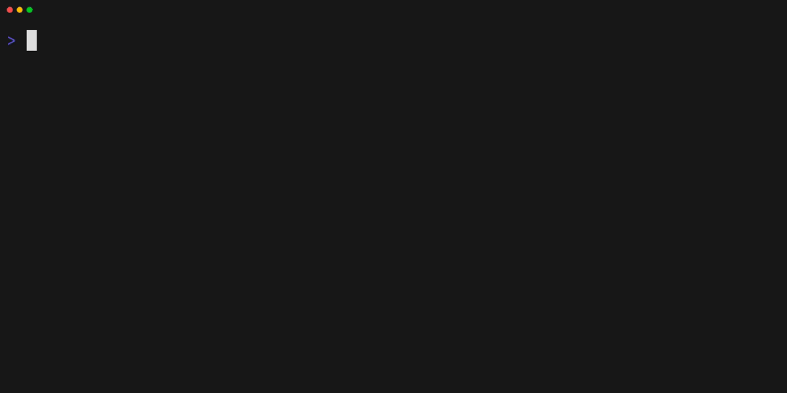

<div align="center">

<h1 align="center">
  <a href="https://mise.jdx.dev">
    <picture>
      <source media="(prefers-color-scheme: dark)" srcset="docs/public/logo-dark.svg" />
      
    </picture>
    <br>
    mise-en-place
  </a>
</h1>

<p>
  <a href="https://crates.io/crates/mise"></a>
  <a href="https://github.com/jdx/mise/blob/main/LICENSE"></a>
  <a href="https://github.com/jdx/mise/actions/workflows/test.yml"></a>
  <a href="https://discord.gg/mABnUDvP57"></a>
</p>

<p align="center">
  <a href="https://www.star-history.com/jdx/mise">
    <picture><source media="(prefers-color-scheme: dark)" srcset="https://api.star-history.com/badge?repo=jdx/mise&type=rank&theme=dark" /><source media="(prefers-color-scheme: light)" srcset="https://api.star-history.com/badge?repo=jdx/mise&type=rank" /></picture> <picture><source media="(prefers-color-scheme: dark)" srcset="https://api.star-history.com/badge?repo=jdx/mise&type=trending&theme=dark" /><source media="(prefers-color-scheme: light)" srcset="https://api.star-history.com/badge?repo=jdx/mise&type=trending" /></picture>
  </a>
</p>

<p><b>Dev tools, env vars, and tasks in one CLI</b></p>

<p align="center">
  <a href="https://mise.jdx.dev/getting-started.html">Getting started</a> •
  <a href="https://mise.jdx.dev">Docs</a> •
  <a href="https://mise.jdx.dev/dev-tools/">Dev tools</a> •
  <a href="https://mise.jdx.dev/environments/">Environments</a> •
  <a href="https://mise.jdx.dev/tasks/">Tasks</a> •
  <a href="https://mise.jdx.dev/bootstrap.html">Bootstrap</a>
</p>

<p align="center">
  Sponsored by<br><br>
  <a href="https://entire.io">
    <picture>
      <source media="(prefers-color-scheme: dark)" srcset="https://jdx.dev/sponsors/entire-lockup.svg">
      
    </picture>
  </a>
  &nbsp;&nbsp;&nbsp;
  <a href="https://omarchy.org/patrons/">
    <picture>
      <source media="(prefers-color-scheme: dark)" srcset="https://jdx.dev/sponsors/omacom-foundation.svg">
      
    </picture>
  </a>
  <br><br>
  <a href="https://jdx.dev/sponsors.html">View all sponsors</a>
</p>

<hr />

</div>

## What is mise?

mise (pronounced "meez", short for _mise-en-place_) manages a project's dev
tools, environment variables, and tasks from one `mise.toml` that works across
your shell, editor, and CI:

```toml
[tools]
node = "24"
python = "3.14"
"github:BurntSushi/ripgrep" = "15"

[env]
NODE_ENV = "development"
_.file = ".env"
_.path = "./node_modules/.bin"

[tasks.build]
description = "Build the application"
run = "npm run build"

[tasks.test]
description = "Run the test suite"
depends = ["build"]
run = "pytest && npm test"
```

- Install [dev tools](https://mise.jdx.dev/dev-tools/) such as Node.js, Python,
  Go, Rust, and Terraform from a
  [registry of 1,000+ tools](https://mise.jdx.dev/registry.html) or directly
  from [backends](https://mise.jdx.dev/dev-tools/backends/) like GitHub
  releases, Aqua, Cargo, npm, and PyPI, with separate versions per project.
- Load [environment variables](https://mise.jdx.dev/environments/), `.env`
  files, `PATH` entries, virtualenvs, and
  [secrets](https://mise.jdx.dev/environments/secrets/) automatically as you
  enter a directory.
- Run [tasks](https://mise.jdx.dev/tasks/) defined in `mise.toml` or as scripts
  in `mise-tasks/`, with dependencies, parallel execution, file watching, and
  the project's tools and environment already configured.
- Set up a machine with [`mise bootstrap`](https://mise.jdx.dev/bootstrap.html)
  and [`mise dotfiles`](https://mise.jdx.dev/dotfiles.html) to apply system
  packages, dotfiles, Git repositories, macOS defaults, and background services.

Adopt only the parts you need. Start with a single tool or task, and keep any
existing `.tool-versions` files as they are; mise also reads `.nvmrc`,
`.python-version`, and other
[idiomatic version files](https://mise.jdx.dev/dev-tools/versions.html#idiomatic-version-files)
once enabled.

[](https://mise.jdx.dev/demo.html)

See the [demo transcript](https://mise.jdx.dev/demo.html#transcript) for the
commands shown above.

## Quickstart

### 1. Install mise

On macOS or Linux:

```sh
curl -fsSL https://mise.run | sh
~/.local/bin/mise --version
```

On Windows, run `winget install jdx.mise`. For Homebrew, apt, dnf, Scoop, and
other package managers, see
[Installing mise](https://mise.jdx.dev/installing-mise.html).

The installer places the binary at `~/.local/bin/mise`. If `~/.local/bin` is not
on your `PATH` yet, run `~/.local/bin/mise` in place of `mise` until you
activate mise in step 4.

### 2. Run a tool without changing your shell

```sh
mise exec node@24 -- node --version
# v24.x.x
```

[`mise exec`](https://mise.jdx.dev/cli/exec.html) downloads Node.js 24 if
needed and runs the command after `--` with that version on `PATH`. Your shell
and config files stay untouched.

### 3. Configure a project

Create a project directory, select Node.js 24, set an environment variable, and
add a task:

```sh
mkdir my-project && cd my-project
mise use node@24
mise set NODE_ENV=development
mise tasks add hello -- node -e "console.log(process.version, process.env.NODE_ENV)"
```

These commands install Node.js 24 and write `mise.toml`:

```toml
[tools]
node = "24"

[env]
NODE_ENV = "development"

[tasks.hello]
run = 'node -e "console.log(process.version, process.env.NODE_ENV)"'
```

Run the task with [`mise run`](https://mise.jdx.dev/cli/run.html):

```sh
mise run hello
# [hello] $ node -e "console.log(process.version, process.env.NODE_ENV)"
# v24.x.x development
```

Commit `mise.toml` so teammates and CI get the same setup when they run
`mise install` or `mise run`. `"24"` requests the latest release in the Node.js
24 series; run `mise lock` to record exact versions and checksums in a
[lockfile](https://mise.jdx.dev/dev-tools/mise-lock.html), or
`mise use --global node@24` to set a personal default in
`~/.config/mise/config.toml`.

### 4. Activate mise in your shell (optional)

Shell activation updates `PATH` and project environment variables whenever you
change directories, so you can invoke `node` directly without `mise exec`. If
you installed with `mise.run`, run the command for your shell once, then open a
new terminal:

```sh
# bash
echo 'eval "$(~/.local/bin/mise activate bash)"' >> ~/.bashrc

# zsh
echo 'eval "$(~/.local/bin/mise activate zsh)"' >> "${ZDOTDIR:-$HOME}/.zshrc"

# fish
mkdir -p ~/.config/fish
echo '~/.local/bin/mise activate fish | source' >> ~/.config/fish/config.fish
```

If a package manager installed mise, use `mise` in place of `~/.local/bin/mise`.
With Homebrew, fish activates mise without this step.

For PowerShell, Nushell, Elvish, Xonsh, and IDE or CI shims, see
[Shell setup](https://mise.jdx.dev/shell-setup.html) and
[Shims](https://mise.jdx.dev/dev-tools/shims.html).

## Everyday commands

| Command                          | Action                                                            |
| -------------------------------- | ----------------------------------------------------------------- |
| `mise use node@24`               | Install a tool and record it in the current project's `mise.toml` |
| `mise use --global node@24`      | Install a tool and set it as your global default                  |
| `mise install`                   | Install all tools declared in the active config files             |
| `mise exec -- <command>`         | Run a command with the project's tools and environment            |
| `mise run <task>`                | Run a project task with its dependencies, tools, and environment  |
| `mise set KEY=value`             | Set an environment variable in `mise.toml`                        |
| `mise env`                       | Print the resolved environment variables and `PATH` changes       |
| `mise ls --current`              | List the tool versions active in the current directory            |
| `mise outdated` / `mise upgrade` | Check for newer tool releases and install upgrades                |
| `mise lock`                      | Write exact tool versions and checksums to `mise.lock`            |
| `mise config ls`                 | Show the config files loaded for the current directory            |
| `mise doctor`                    | Check your mise installation, shell activation, and configuration |

## Set up a machine with mise bootstrap

Beyond project directories, `~/.config/mise/config.toml` can declare the state
of your machine:

```toml
[bootstrap.packages]
"apt:build-essential" = "latest"
"brew:jq" = "latest"

[bootstrap.repos]
"~/src/app" = { url = "https://github.com/you/app.git" }

[dotfiles]
"~/.zshrc" = { mode = "track" }
```

Preview and apply the configuration, or bootstrap a new machine directly from a
Git repository:

```sh
mise bootstrap --dry-run
mise bootstrap
mise bootstrap --adopt you/dotfiles
```

See [Bootstrap](https://mise.jdx.dev/bootstrap.html) and
[Dotfiles](https://mise.jdx.dev/dotfiles.html) for supported package managers,
dotfile tracking and templating, services, and remote SSH targets.

## Documentation

| Topic                         | Guides                                                                                                                                                                                                                                                                 |
| ----------------------------- | ---------------------------------------------------------------------------------------------------------------------------------------------------------------------------------------------------------------------------------------------------------------------- |
| Onboarding                    | [Getting started](https://mise.jdx.dev/getting-started.html) · [Existing projects](https://mise.jdx.dev/walkthrough.html) · [Migrating from asdf](https://mise.jdx.dev/dev-tools/comparison-to-asdf.html)                                                              |
| Dev tools                     | [Dev tools](https://mise.jdx.dev/dev-tools/) · [Registry](https://mise.jdx.dev/registry.html) · [Backends](https://mise.jdx.dev/dev-tools/backends/) · [Lockfile](https://mise.jdx.dev/dev-tools/mise-lock.html)                                                       |
| Environments and tasks        | [Environments](https://mise.jdx.dev/environments/) · [Secrets](https://mise.jdx.dev/environments/secrets/) · [Tasks](https://mise.jdx.dev/tasks/) · [Task configuration](https://mise.jdx.dev/tasks/task-configuration.html)                                           |
| Machine setup                 | [Bootstrap](https://mise.jdx.dev/bootstrap.html) · [Packages](https://mise.jdx.dev/bootstrap/packages/) · [Dotfiles](https://mise.jdx.dev/dotfiles.html) · [Services](https://mise.jdx.dev/bootstrap/services.html)                                                    |
| Shells, editors, and CI       | [Shell setup](https://mise.jdx.dev/shell-setup.html) · [Shims](https://mise.jdx.dev/dev-tools/shims.html) · [Editors and IDEs](https://mise.jdx.dev/ide-integration.html) · [Continuous integration](https://mise.jdx.dev/continuous-integration.html)                 |
| Reference and troubleshooting | [mise.toml](https://mise.jdx.dev/configuration.html) · [Settings](https://mise.jdx.dev/configuration/settings.html) · [CLI reference](https://mise.jdx.dev/cli/) · [Troubleshooting](https://mise.jdx.dev/troubleshooting.html) · [FAQ](https://mise.jdx.dev/faq.html) |
| Contributing                  | [Contributing](CONTRIBUTING.md) · [Writing docs](docs/README.md)                                                                                                                                                                                                       |

## Get help

- Report bugs in [GitHub Issues](https://github.com/jdx/mise/issues). Check
  [Troubleshooting](https://mise.jdx.dev/troubleshooting.html) first, and
  include the command you ran, a minimal `mise.toml`, the expected and actual
  behavior, and your `mise doctor` output after reviewing it for private
  details.
- Ask questions and share ideas in
  [GitHub Discussions](https://github.com/jdx/mise/discussions).
- Chat with the community on [Discord](https://discord.gg/mABnUDvP57).

For security reports and other inquiries, see
[Contact](https://mise.jdx.dev/contact.html). Before using AI to reply to an
Issue or Discussion, read the
[AI reply policy](https://mise.jdx.dev/contributing.html#community-participation).

## Special thanks

<p>
  <a href="https://namespace.so">
    
  </a>
  <br>
  Thanks to <a href="https://namespace.so">Namespace</a> for providing CI services for mise.
</p>

## Contributors

[](https://github.com/jdx/mise/graphs/contributors)
